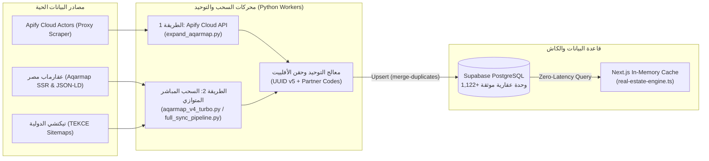

# دليل منظومة سحب البيانات العقارية وتطوير المخزون (Data Sync & Scraping Architecture)

يوثق هذا الدليل الآلية الهندسية المعتمدة في مشروع **سكنى بوت (Skanybot)** لجلب وتحديث وتوحيد بيانات الوحدات العقارية المصرية والدولية، مع شرح تفصيلي **للطريقتين الأساسيتين (Dual-Mode Data Fetching)** المستخدمتين في المشروع، والتطويرات الجديدة التي تم تنفيذها لتوسيع قاعدة البيانات.

---

## 1. نظرة عامة على البنية المعمارية (Zero-Load Decoupled Architecture)

لتجنب أي بطء أو استهلاك للموارد على سيرفر الواجهة الأمامية (**Vercel / Next.js**)، يعمل النظام بمعمارية مفصولة تماماً من 3 طبقات:



1. **طبقة السحب الخلفية (Python / Hugging Face Docker Worker):** تعمل في الخلفية أو عبر أوامر مباشرة لسحب البيانات وتنظيفها وحساب خطط الدفع.
2. **طبقة التخزين الموحدة (Supabase PostgreSQL):** تخزن الوحدات في جدول `public.properties` مربوطة بالمشاريع والمناطق في `public.compounds_projects` والمطورين في `public.developers`.
3. **طبقة القراءة الفورية (Next.js Runtime Cache):** يقرأ ملف [`src/lib/real-estate-engine.ts`](file:///c:/Users/MR__CODER__/Desktop/Skanybot/src/lib/real-estate-engine.ts) البيانات الجاهزة من Supabase ويحتفظ بها في ذاكرة مؤقتة (`CACHE_TTL_MS = 3 minutes`) ليقوم وكيل الذكاء الاصطناعي بالرد في أجزاء من الثانية.

---

## 2. الطريقة الأولى: السحب السحابي عبر Apify Cloud Actors

تعتمد هذه الطريقة على استدعاء خوادم **Apify** السحابية المزودة ببروكسيات متغيرة (Rotating Proxies) ومتصفحات سحابية لتجاوز أي حظر أو حماية (Cloudflare / Rate Limiting) عند سحب دفعات ضخمة.

### الملفات المسؤولة في المشروع:
- [`scripts/expand_aqarmap.py`](file:///c:/Users/MR__CODER__/Desktop/Skanybot/scripts/expand_aqarmap.py)
- [`hf_sync_engine/full_sync_pipeline.py`](file:///c:/Users/MR__CODER__/Desktop/Skanybot/hf_sync_engine/full_sync_pipeline.py) (دالة `fetch_aqarmap_units_from_apify` ودالة `normalize_apify_items`)

### كيف تعمل خطوة بخطوة؟
1. **إرسال طلب التشغيل (Trigger Actor Run):**
   يقوم السكربت بإرسال طلب `POST` إلى واجهة Apify REST API لتشغيل الـ Actor المتخصص (`sian.agency~aqarmap-property-scraper` أو `parseforge~aqarmap-egypt-scraper`) مع تمرير قائمة روابط البحث `startUrls` وتفعيل البروكسي السحابي:
   ```json
   {
     "startUrls": [
       { "url": "https://aqarmap.com.eg/ar/for-sale/property-type/cairo/new-cairo/" },
       { "url": "https://aqarmap.com.eg/ar/for-sale/property-type/cairo/el-sheikh-zayed-city/" }
     ],
     "maxItems": 200,
     "proxyConfiguration": { "useApifyProxy": true }
   }
   ```
2. **مراقبة حالة التشغيل (Polling Status):**
   يتابع السكربت حالة الـ `run_id` كل بضع ثوانٍ عبر الرابط `/v2/actor-runs/{run_id}` حتى تتحول الحالة إلى `SUCCEEDED`.
3. **سحب حزمة البيانات (Dataset Fetch):**
   بمجرد نجاح المهمة، يستخرج السكربت معرف قاعدة البيانات المؤقتة `defaultDatasetId` ويسحب جميع الوحدات بصيغة JSON عبر `/v2/datasets/{dataset_id}/items`.
4. **التطبيع والتوحيد (`normalize_apify_items`):**
   - تحويل الأسعار النصية إلى أرقام عشرية واستبعاد الإعلانات غير المكتملة أو الوهمية.
   - استخراج عدد الغرف والحمامات والمساحة بالمتر المربع.
   - التحقق من وجود صور حقيقية من خوادم عقارماب واستبعاد أي صور احتياطية (`unsplash`).
   - ربط الوحدة بالمنطقة أو الكمبوند المناسب وحقن كود الأفلييت.

### مميزات ومتى نستخدم الطريقة الأولى:
- **المميزات:** لا تستهلك عنوان الـ IP المحلي، وتتخطى حماية البوتات تلقائياً بفضل `Apify Proxy`.
- **القيود:** تعتمد على الرصيد المتاح في حساب Apify (`APIFY_TOKEN`) وتستغرق وقتاً أطول (1 إلى 3 دقائق) لانتظار إقلاع الحاوية السحابية.

---

## 3. الطريقة الثانية: السحب المباشر المتوازي فائق السرعة (Direct Multi-Threaded SSR / JSON-LD & Sitemap Engine)

تعتمد هذه الطريقة على الاتصال المباشر المتوازي (`ThreadPoolExecutor`) بصفحات العقارات وتحليل البيانات المهيكلة المدمجة داخل كود الصفحة (**Server-Side Rendered JSON-LD & Hydration State**) وملفات خرائط المواقع (**XML Sitemaps**) بدون الحاجة لمتصفح ثقيل أو وسيط خارجي.

### الملفات المسؤولة في المشروع:
- **للعقارات المصرية (Aqarmap & Nawy Primary Compounds):**
  - [`scripts/aqarmap_v4_turbo.py`](file:///c:/Users/MR__CODER__/Desktop/Skanybot/scripts/aqarmap_v4_turbo.py) *(الإصدار الرابع المطور لسحب عقارماب — JSON-LD + SSR Plans)*
  - [`scripts/nawy_compounds_scraper.py`](file:///c:/Users/MR__CODER__/Desktop/Skanybot/scripts/nawy_compounds_scraper.py) *(محرك سحب كمبوندات المطورين الأولية من Nawy عبر `__NEXT_DATA__` مع الإبقاء على توجيه الأفلييت لكود عقارماب `759279`)*
  - [`scripts/aqarmap_v3.py`](file:///c:/Users/MR__CODER__/Desktop/Skanybot/scripts/aqarmap_v3.py) و [`scripts/aqarmap_direct_scraper.py`](file:///c:/Users/MR__CODER__/Desktop/Skanybot/scripts/aqarmap_direct_scraper.py)
  - [`hf_sync_engine/full_sync_pipeline.py`](file:///c:/Users/MR__CODER__/Desktop/Skanybot/hf_sync_engine/full_sync_pipeline.py) (دالة `fetch_aqarmap_direct_parallel`)
- **للعقارات الدولية (TEKCE — دبي، تركيا، إسبانيا، قبرص):**
  - [`hf_sync_engine/full_sync_pipeline.py`](file:///c:/Users/MR__CODER__/Desktop/Skanybot/hf_sync_engine/full_sync_pipeline.py) (دالة `fetch_all_tekce_parallel`)
  - [`scripts/sync_affiliate_data.py`](file:///c:/Users/MR__CODER__/Desktop/Skanybot/scripts/sync_affiliate_data.py)

### كيف تعمل خطوة بخطوة؟

#### أ) في العقارات المصرية (Aqarmap Direct Engine):
1. **اكتشاف الإعلانات المتوازن (Balanced Regional Discovery):**
   يزحف المحرك على 24 صفحة بحث عربية مقسمة بالتساوي بين المناطق السكنية والساحلية (`/ar/for-sale/...`) ويقارن أرقام الإعلانات المكتشفة (`listing_id`) بما هو موجود مسبقاً في Supabase لتجنب إعادة سحب الوحدات الموجودة.
2. **استخراج البيانات المهيكلة (`application/ld+json`):**
   يقرأ المحرك وسم `<script type="application/ld+json">` من نوع `@type: RealEstateListing` للحصول على:
   - العنوان العربي الكامل للوحدة (`name`)
   - السعر الرسمي بالجنيه المصري (`offers.price`)
   - عدد الغرف (`numberOfRooms`) والحمامات (`numberOfBathroomsTotal`) والمساحة (`floorSize.value`)
   - العنوان والمنطقة الجغرافية (`addressRegion` / `addressLocality`).
3. **استخراج خطط الدفع والتقسيط الحقيقية من الـ SSR (`payment_plans`):**
   يحلل المحرك كائنات `payment_plans` المدمجة في الـ HTML ليستخرج:
   - نسبة المقدم الحقيقية (`down_payment_percentage`) أو قيمة المقدم (`total_down_payment`)
   - عدد سنوات التقسيط الفعلية (`duration / 360`)
   - القسط الشهري والربع سنوي بدقة حسابية.
4. **فلترة الصور عالية الدقة (High-Res CDN Extraction):**
   يستخرج المحرك فقط روابط الصور الرسمية عالية الجودة من خوادم `https://img-*.aqarmap.com.eg/.../large/...` ويستبعد أي صور مصغرة (`thumb` / `small`) أو شعارات.

#### ب) في العقارات الدولية (TEKCE Sitemap & Meta Engine):
1. يقرأ خريطة الموقع الرسمية `https://tekce.com/sitemap-en.xml` ويصنف الروابط حسب كود الدولة/المدينة:
   - دبي والإمارات (`/dxb-`) — بالدرهم الإماراتي `AED`
   - إسطنبول وأنطاليا (`/ist-`, `/ayt-`) — بالدولار الأمريكي `USD`
   - مالقة وماربيا وإسبانيا (`/agp-`, `/alc-`) — باليورو `EUR`
   - قبرص (`/cy-`) — باليورو `EUR`
2. يسحب الصفحات بالتوازي (`ThreadPoolExecutor`) ويستخرج الصور الأصلية من `static.tekce.com` والأسعار والمساحات ويترجم العناوين تلقائياً إلى العربية.

---

## 4. آليات منع التكرار وحقن أكواد الأفلييت (Deduplication & Affiliate Tracking)

تشترك الطريقتان في طبقة توحيد صارمة تضمن نظافة قاعدة البيانات وحفظ حقوق العمولة:

1. **المعرف الحتمي لمنع التكرار (Deterministic UUID v5):**
   كل وحدة عقارية تحصل على `id` ثابت مشتق خوارزمياً من رقم الإعلان أو رابطه باستخدام `uuid.uuid5`:
   ```python
   def deterministic_uuid(namespace_str: str, key_str: str) -> str:
       namespace = uuid.UUID("6ba7b810-9dad-11d1-80b4-00c04fd430c8")
       return str(uuid.uuid5(namespace, f"{namespace_str}:{key_str}"))
   ```
   عند الرفع إلى Supabase مع الترويسة `Prefer: resolution=merge-duplicates`، يتم تحديث الوحدة إن كانت موجودة أو إضافتها إن كانت جديدة **بصفر تكرار**.

2. **حقن روابط الأفلييت والشراكة تلقائياً:**
   - **عقارماب (Aqarmap Partner Code `759279`):**
     يتم إلحاق معاملات الشراكة بكل رابط وحدة في حقل `affiliate_url`:
     `?utm_source=partners&utm_medium=dynamic&utm_campaign=affiliate_759279&partner_code=759279`
   - **تيكتشي (TEKCE Partner Code `6FPC68983C`):**
     يتم إلحاق معاملات الإحالة الدولية بكل رابط:
     `?utm_source=taff&utm_medium=6FPC68983C`

---

## 5. التطويرات التي تم تنفيذها وتوسيع المخزون العقاري (تحديث v4 Turbo)

### أ) ما الذي تم تطويره في الكود وقاعدة البيانات؟
1. **بناء المحرك المطور [`scripts/aqarmap_v4_turbo.py`](file:///c:/Users/MR__CODER__/Desktop/Skanybot/scripts/aqarmap_v4_turbo.py):**
   - التحول من سحب الصفحات الإنجليزية فقط إلى سحب الصفحات العربية (`/ar/for-sale/...`) للحصول على عناوين وتفاصيل عربية غنية ودقيقة.
   - إضافة محلل `extract_payment_plan` لاستخراج خطط التقسيط الحقيقية من بيانات SSR بدلاً من الاعتماد على نسبة ثابتة فقط.
   - تطبيق خوارزمية **السحب المتوازن (Balanced Regional Sampling)** التي تأخذ عينة متوازنة من 24 صفحة بحث تغطي جميع المناطق الحيوية في مصر.
   - دعم تصنيف أنواع وحدات جديدة: `شاليه`، `تاون هاوس`، `بنتهاوس`، `دوبلكس`، `استوديو`، `فيلا`، `شقة`، و`تجاري / إداري`.
2. **توسيع جدول المناطق والمشاريع (`public.compounds_projects`) إلى 14 منطقة وكمبوند:**
   تمت إضافة 6 تجمعات إقليمية جديدة في Supabase وإعادة ربط الوحدات بها بدقة بدلاً من تجميعها في منطقة واحدة:
   - الساحل الشمالي ورأس الحكمة والعلمين (`00000000-0000-0000-0000-000000000003`)
   - العين السخنة والجلالة (`00000000-0000-0000-0000-000000000004`)
   - المستقبل سيتي والشروق والعبور (`00000000-0000-0000-0000-000000000005`)
   - الإسكندرية — سموحة وستانلي (`00000000-0000-0000-0000-000000000006`)
   - وسط وشرق القاهرة — المعادي ومصر الجديدة ومدينة نصر (`00000000-0000-0000-0000-000000000007`)
   - مدينة 6 أكتوبر وحدائق أكتوبر (`00000000-0000-0000-0000-000000000008`)
3. **ترقية خط السحب السحابي [`hf_sync_engine/full_sync_pipeline.py`](file:///c:/Users/MR__CODER__/Desktop/Skanybot/hf_sync_engine/full_sync_pipeline.py) ومحرك البحث الذكي:**
   - تحديث `AQARMAP_AREA_MAP` و `search_templates` في [`hf_sync_engine/full_sync_pipeline.py`](file:///c:/Users/MR__CODER__/Desktop/Skanybot/hf_sync_engine/full_sync_pipeline.py) ليدعم الـ 14 منطقة تلقائياً.
   - تحديث المرادفات الجغرافية وأنواع الوحدات في [`src/lib/real-estate-engine.ts`](file:///c:/Users/MR__CODER__/Desktop/Skanybot/src/lib/real-estate-engine.ts) و [`src/lib/ai/agentic-tools.ts`](file:///c:/Users/MR__CODER__/Desktop/Skanybot/src/lib/ai/agentic-tools.ts) ليفهم البوت طلبات مثل *"عايز شاليه في الساحل أو السخنة"* أو *"شقة في مصر الجديدة أو المعادي أو الشروق"*.

---

### ب) إحصائيات المخزون العقاري الحالية في قاعدة البيانات (100% عقارات مصرية)

تم حذف جميع الوحدات الأجنبية (TEKCE) بالكامل واستبدالها بمخزون عقاري مصري ضخم وموثق بنسبة 100% بالجنيه المصري (`EGP`)، ليصبح إجمالي المخزون النشط في `public.properties` هو **2,841 وحدة عقارية مصرية موثقة**:

| المصدر | عدد الوحدات الموثقة | التوزيع الجغرافي في مصر |
| :--- | :---: | :--- |
| **مشاريع المطورين الأولية (Nawy Primary Compounds)** | **2,725 وحدة** | التجمع الخامس والقاهرة الجديدة، الشيخ زايد و6 أكتوبر، الساحل الشمالي ورأس الحكمة، العاصمة الإدارية، العين السخنة والجلالة، المستقبل سيتي والشروق ومدينتي |
| **إعلانات ووحدات عقارماب مصر (Aqarmap Direct)** | **116 وحدة** | مصر الجديدة، مدينة نصر، المعادي، التجمع الخامس، الشيخ زايد، أكتوبر، الساحل الشمالي، العين السخنة، الشروق، الإسكندرية |
| **الإجمالي الكلي (مصر فقط 🇪🇬)** | **2,841 وحدة** | **تغطية شاملة لجميع أنواع الوحدات (شقق، فيلات، شاليهات، تاون هاوس، دوبلكس، استوديو، بنتهاوس، تجاري/إداري)** |

#### التوزيع التفصيلي حسب المناطق في قاعدة البيانات:
- **التجمع الخامس والقاهرة الجديدة (ماونتن فيو، زد إيست، ميفيدا، هايد بارك):** 1,001 وحدة
- **الشيخ زايد ومدينة 6 أكتوبر وحدائق أكتوبر (بادية، أو ويست، سوديك):** 689 وحدة
- **الساحل الشمالي ورأس الحكمة والعلمين الجديدة:** 456 وحدة
- **العاصمة الإدارية الجديدة (البوسكو، R7، R8، حي المال والأعمال):** 306 وحدة
- **المستقبل سيتي والشروق والعبور ومدينتي والرحاب:** 240 وحدة
- **العين السخنة ومدينة الجلالة (المونت جلالة، أزها، لافيستا):** 131 وحدة
- **وسط وشرق القاهرة (المعادي، مصر الجديدة، مدينة نصر):** 52 وحدة
- **الإسكندرية (سموحة، ستانلي، بالم هيلز الإسكندرية):** 6 وحدات

---

## 6. كيفية تشغيل السحب وإضافة وحدات جديدة في أي وقت

يمكنك زيادة المخزون العقاري في أي وقت بضغطة واحدة عبر تشغيل المحركات المطورة:

```powershell
$env:SUPABASE_SERVICE_ROLE_KEY = (Get-Content .env.local | Where-Object { $_ -match '^SUPABASE_SERVICE_ROLE_KEY=' } | ForEach-Object { ($_ -split '=', 2)[1].Trim('"') })

# 1. سحب وحدات إضافية من عقارماب (تحدد عدد الوحدات مثلاً 80)
python -u scripts\aqarmap_v4_turbo.py 80

# 2. سحب وحدات مشاريع المطورين الأولية من ناوي Nawy (تحدد عدد الصفحات مثلاً 20 صفحة = ~240 وحدة)
python -u scripts\nawy_compounds_scraper.py 20

# 3. أو تشغيل خط السحب الشامل (Aqarmap + TEKCE معاً)
python -u hf_sync_engine\full_sync_pipeline.py
```
