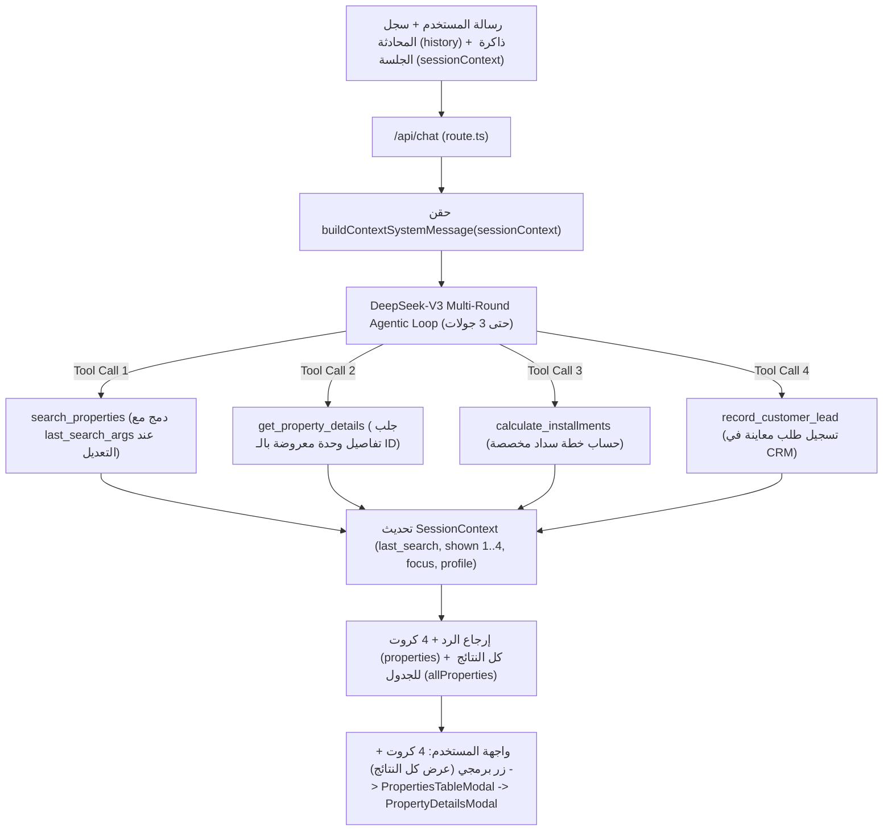

# وثيقة التحول الجذري لمعمارية الشات بوت الذكية، ذاكرة المحادثة، وجدول النتائج الشامل
> **تاريخ التوثيق والتنفيذ:** 31 أكتوبر 2026  
> **المشروع:** منصة `sakanybot` (سكنى بوت) — مستشارك العقاري الذكي والبروكر المعتمد في مصر ودولياً  
> **حالة الاعتماد:** معتمد وموثق باجتياز الاختبارات الحية الميدانية بنجاح تام (**QA Review: PASS √**)  
> **المحرك الأساسي:** [`src/lib/deepseek.ts`](file:///c:/Users/MR__CODER__/Desktop/Skanybot/src/lib/deepseek.ts) & [`src/lib/ai/agentic-tools.ts`](file:///c:/Users/MR__CODER__/Desktop/Skanybot/src/lib/ai/agentic-tools.ts) & [`src/lib/ai/session-context.ts`](file:///c:/Users/MR__CODER__/Desktop/Skanybot/src/lib/ai/session-context.ts)  
> **النموذج اللغوي المسؤول:** DeepSeek-V3 (`deepseek-chat`) عبر بروتوكول Multi-Round Function Calling المتقدم  
> **المرجع المعماري المستنسخ:** مشروع المنصة المالية [`stokscan_AI`](file:///C:/Users/MR__CODER__/Desktop/stokscan_AI)

---

## 0. بطاقة التوثيق وسجل المشكلة والحل (Executive Audit Card)

| البند | البيان التفصيلي |
| :--- | :--- |
| **اسم الملف** | [`doc/معمارية_الشات_بوت_الذكية_وتحسين_البحث_2026-10-31.md`](file:///c:/Users/MR__CODER__/Desktop/Skanybot/doc/معمارية_الشات_بوت_الذكية_وتحسين_البحث_2026-10-31.md) |
| **المشكلات المرصودة** | 1. تكرار نفس الـ 4 وحدات العقارية الثابتة في كل سؤال أياً كانت الميزانية المطلوبة. 2. اقتصار العرض على 4 كروت فقط دون إمكانية تصفح باقي الوحدات المطابقة في قاعدة البيانات. 3. ضعف استيعاب سياق المتابعة في المحادثة (مثل: *"طب التانية دي تفاصيلها إيه؟"*، أو *"طب لو 3 غرف ورتبهم من الأرخص؟"*) بسبب عدم تمرير سجل المحادثة وذاكرة الوحدات المعروضة للـ LLM. |
| **الأسباب الجذرية الحقيقية (Root Causes)** | **1. غياب Function Calling:** كان مسار API يجلب أول 4 وحدات مميزة فقط ويجبر الموديل على الرد منها. **2. عدم إرجاع القائمة الكاملة للواجهة:** كان الباك-إند يقتطع `.slice(0, 4)` ولا يرسل باقي النتائج المفلترة لبناء جدول تفاعلي. **3. فجوة ذاكرة الجلسة (`history` & `SessionContext`):** كانت الواجهة ترسل `history` بينما يقرأ الباك-إند `messages`، كما أن النص المكتوب للمساعد لا يحتوي على مُعرّفات (`id`) الوحدات الـ 4 المعروضة في الكروت أو فلاتر آخر بحث (`last_search_args`). |
| **الحل الجذري المعتمد** | **1. محرك Agentic متعدد الجولات (`MAX_TOOL_ROUNDS = 3`):** تزويد DeepSeek بأربع أدوات: `search_properties`، و`get_property_details`، و`calculate_installments`، و`record_customer_lead`. **2. عرض 4 كروت + زر برمجي لجدول كل النتائج (`PropertiesTableModal`):** يعرض الشات 4 كروت، وإذا زادت النتائج المطابقة عن 4 يظهر زر برمجي **`عرض كل النتائج (X)`** يفتح جدولاً تفاعلياً قابلاً للفرز مع زر **`عرض البيانات`** لفتح نافذة التفاصيل الكاملة (`PropertyDetailsModal`). **3. ذاكرة المحادثة المهيكلة (`SessionContext` على غرار `stokscan_AI`):** حقن رسالة نظام (`buildContextSystemMessage`) في كل جولة تحتوي على: `last_search_args`، والوحدات المعروضة مرقمة `1..4` (`units_shown_to_user_in_last_reply`)، والوحدة المفتوحة حالياً (`unit_user_is_looking_at_now`)، والملف التراكمي للمشتري (`buyer_profile_so_far`). |

---

## 1. مخطط المعمارية الذكية وذاكرة السياق (Architecture & Memory Flow)

---

## 2. حزمة الأدوات الذكية المعتمدة (The 4 Core Agentic Tools)

تم تعريف مخطط الأدوات وتنفيذها في [`src/lib/ai/agentic-tools.ts`](file:///c:/Users/MR__CODER__/Desktop/Skanybot/src/lib/ai/agentic-tools.ts):

### 1. أداة البحث في العقارات (`search_properties`)
- **الوظيفة:** استعلام فوري في قاعدة بيانات الوحدات العقارية في مصر ودولياً مع حساب المسافة السعرية (`target_price` proximity).
- **المعاملات المدعومة:** `unit_type`, `location`, `target_price`, `min_price`, `max_price`, `currency`, `bedrooms`, `query`, `delivery_type`, بالإضافة إلى معامل الترتيب `sort` (`relevance` | `price_asc` | `price_desc` | `area_desc`).
- **المخرجات:** ترجع أول 4 وحدات للكروت (`cards`) + قائمة كافة الوحدات المطابقة (`allProperties` حتى 100 وحدة) لعرضها في الجدول البرمجي + إجمالي عدد التطابقات (`totalMatches`).

### 2. أداة تفاصيل الوحدة الكاملة (`get_property_details`)
- **الوظيفة:** جلب جميع بيانات ومرافق وصور وخطة سداد وحدة محددة عبر `property_id` عندما يسأل العميل في سياق المتابعة عن وحدة معروضة أمامه (مثل: *"التانية دي تفاصيلها إيه؟"* أو *"دي استلام امتى؟"*).

### 3. أداة حساب الأقساط والمقدم (`calculate_installments`)
- **الوظيفة:** حسابات رياضية دقيقة للمقدم والقسط الشهري والربع سنوي وإجمالي المبلغ بدون أي تقريب عشوائي.

### 4. أداة تسجيل العملاء والمعاينات (`record_customer_lead`)
- **الوظيفة:** التقاط رقم الهاتف أو الواتساب المسجل في المحادثة وحفظه في جدول `leads_inquiries` لربط العميل بإدارة المشروع الرسمية فوراً.

---

## 3. نظام ذاكرة المحادثة وفهم السياق (`SessionContext`)

تم بناء [`src/lib/ai/session-context.ts`](file:///c:/Users/MR__CODER__/Desktop/Skanybot/src/lib/ai/session-context.ts) محاكاةً لمعمارية الذاكرة في `stokscan_AI`:
1. **`last_search_args`**: يحتفظ بآخر فلاتر بحث استخدمها العميل. إذا قال العميل في الرسالة التالية *"طب لو 3 غرف؟"* أو *"رتبهم من الأرخص"*، يقوم الموديل بدمج التعديل الجديد مع الفلاتر السابقة تلقائياً.
2. **`units_shown_to_user_in_last_reply`**: قائمة مرقمة (`n: 1..4`) بالوحدات الأربع المعروضة أمام العميل حالياً شاملةً `id` والسعر والمقدم والقسط الشهري، مما يمكّن الموديل من فهم *"الأولى"*، *"التانية"*، *"الأرخص فيهم"* فوراً.
3. **`unit_user_is_looking_at_now` (`focus`)**: عند ضغط المستخدم على زر **"معاينة الصور / عرض البيانات"** لأي وحدة في الكروت أو في الجدول، تُحفظ هذه الوحدة في `sessionContext.focus`، بحيث لو سأل العميل بعدها *"دي قسطها كام؟"* يفهم الشات تلقائياً أي وحدة يقصدها.
4. **`buyer_profile_so_far`**: يراكم ميزانية العميل، المناطق المفضلة، أنواع الوحدات، وعدد الغرف عبر جولات الحوار.

---

## 4. جدول كل النتائج البرمجي (`PropertiesTableModal`)

تم إنشاء المكون [`src/components/PropertiesTableModal.tsx`](file:///c:/Users/MR__CODER__/Desktop/Skanybot/src/components/PropertiesTableModal.tsx) وربطه في [`src/app/page.tsx`](file:///c:/Users/MR__CODER__/Desktop/Skanybot/src/app/page.tsx):
- يعرض الشات دائماً **4 كروت** كحد أقصى داخل فقاعة الرد للحفاظ على نظافة المحادثة.
- إذا كان عدد النتائج المطابقة أكبر من 4، يظهر زر برمجي أسفل الكروت: **`عرض كل النتائج (X)`** (بدون إرسال رسالة جديدة للشات).
- عند الضغط عليه، تفتح نافذة جدول كامل يحتوي على كافة النتائج المطابقة مع إمكانية الفرز الفوري (**الأقرب لطلبك**، **الأقل سعراً**، **الأعلى سعراً**، **الأكبر مساحة**).
- يحتوي كل صف في الجدول على زر **`عرض البيانات`** الذي يفتح شاشة العرض الكاملة الموجودة مسبقاً ([`PropertyDetailsModal.tsx`](file:///c:/Users/MR__CODER__/Desktop/Skanybot/src/components/PropertyDetailsModal.tsx)) بكامل الصور والتفاصيل.

---

## 5. نتائج اختبارات السياق متعدد الجولات (Multi-Turn Memory Benchmarks)

تم اختبار سيناريو محادثة متكامل من 3 جولات متتالية عبر `POST /api/chat`:

- **الجولة 1:** `"عايز شقق في حدود 5 مليون"`
  - استدعى `search_properties(unit_type: 'شقة', target_price: 5000000)`.
  - أرجع **4 كروت** للعرض + **100 وحدة** في `allProperties` (من إجمالي 164 مطابقة) + حفظ الوحدات الـ 4 في `sessionContext.shown`.
- **الجولة 2:** `"طب التانية دي مساحتها وتفاصيلها إيه واحسبلي قسطها لو دفعت مقدم 15% على 7 سنين؟"`
  - تعرف الموديل فوراً على **الوحدة رقم 2** من `sessionContext.shown` (`Apartment 150 M² Semi Finished in El Andalus 1` بسعر 5,000,000 جنيه).
  - استدعى `get_property_details` و`calculate_installments` في نفس الجولة، وعرض تفاصيل الوحدة التانية وحسبة القسط الدقيقة دون أن يسأل العميل "أي وحدة تقصد؟".
- **الجولة 3:** `"طب لو عايزهم 3 غرف ورتبهملي من الأرخص للأغلى؟"`
  - دمج الموديل الطلب الجديد مع `last_search_args` السابقة ليستدعي:
    `search_properties(unit_type: 'شقة', target_price: 5000000, bedrooms: 3, sort: 'price_asc')`.
  - أرجع 25 وحدة مطابقة (4 كروت مرتبة تصاعدياً: 4.25M، 4.95M، 4.95M، 5.185M + زر عرض الـ 25 نتيجة في الجدول).
