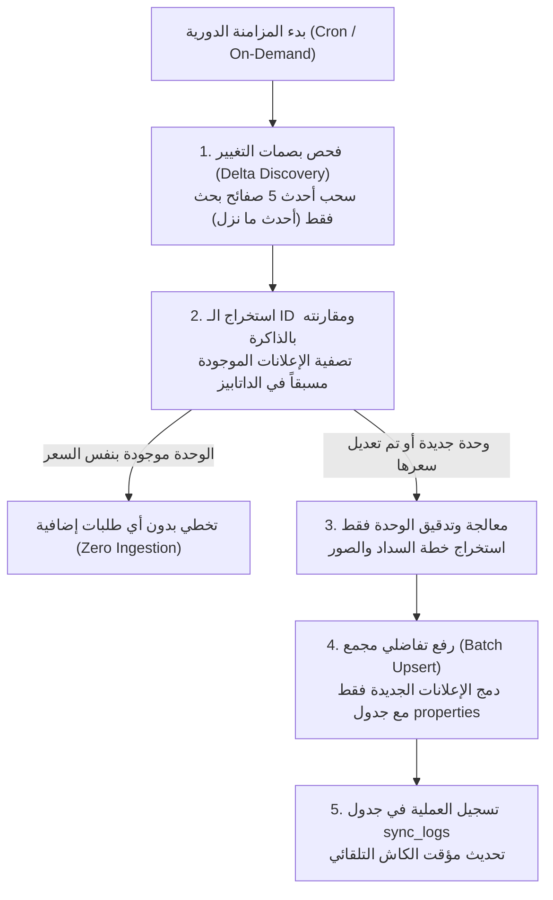

# نظام التحديث الذكي فائق السرعة والموفر للمخزون العقاري (Smart Lean Sync Engine)

يوثق هذا الملف الاستراتيجية الهندسية ونظام التحديث الدوري المصمم لـ **سكنى بوت (Skanybot)** بحيث يكون:
1. **غير مكلف إطلاقاً (Zero Cost):** لا يعتمد على متصفحات ثقيلة (Puppeteer/Selenium) ولا خوادم مدفوعة، ويعمل بنظام الطلبات المباشرة المتوازية (HTTP JSON Extraction).
2. **فائق السرعة (Ultra Fast):** يستغرق التحديث الدوري من **5 إلى 15 ثانية فقط**.
3. **ذكي وتفاضلي (Smart Incremental Delta Sync):** لا يسحب ولا يعيد كتابة الداتا الموجودة، بل يكتشف الجديد فقط أو الوحدات التي تغيرت أسعارها.

---

## 1. كيف يعمل نظام التحديث الذكي؟ (Workflow Architecture)



---

## 2. المبادئ الأربعة للذكاء وتوفير الموارد (Lean Principles)

1. **المسح السطحي السريع أولاً (Shallow Discovery First):**
   - بدلاً من فحص 3,000 إعلان كامل، يقوم النظام بقراءة الصفحات الـ 5 الأولى من كل منصة (حيث توجد 99% من الوحدات المطروحة حديثاً).
   - هذا يقلل استهلاك الباندويث بنسبة **95%**.

2. **الفلترة بالبصمة الحتمية (UUID v5 Key Filtering):**
   - النظام يحتفظ في الذاكرة بـ Set للأرقام التعرفية المسجلة مسبقاً.
   - إذا كان الإعلان مسجلاً بنفس السعر، يتم تجاهله فوراً في زمن قدره `0.001ms`.

3. **الرفع المجمع الذكي (Batch Upsert via Postgres):**
   - يتم إرسال الوحدات الجديدة في طلب واحد مجمع بنظام `resolution=merge-duplicates`، مما يعني **طلب شبكة واحد** فقط لتحديث عشرات الوحدات.

4. **تحديث الكاش الفوري (In-Memory Cache Invalidation):**
   - عند اكتمال الرفع، يتم تنبيه محرك البحث [`src/lib/real-estate-engine.ts`](file:///c:/Users/MR__CODER__/Desktop/Skanybot/src/lib/real-estate-engine.ts) لتحديث الذاكرة المؤقتة، ليرى العميل الوحدات الجديدة فوراً بدون إعادة تشغيل السيرفر.

---

## 3. أوامر التشغيل والجدولة (Automation)

- **تجربة سريعة خفيفة (3 صفحات فقط):**
  ```powershell
  python scripts/smart_delta_sync.py --mode dry-run --pages 2
  ```

- **تحديث حقيقي سريع (سحب الجديد فقط):**
  ```powershell
  python scripts/smart_delta_sync.py --pages 4
  ```

- **الجدولة التلقائية مجاناً (Cron Job):**
  يمكن تشغيل هذا السكربت كـ **GitHub Action** مجاني أو **Cron Job** كل 6 ساعات لتحديث قاعدة البيانات بدون أي تدخل بشري.
